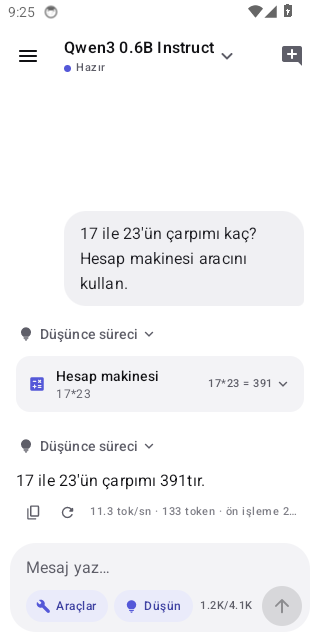
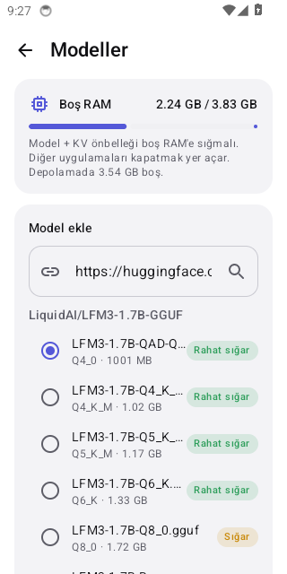
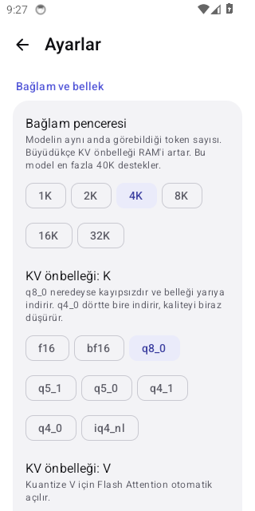
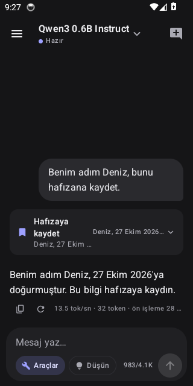

# Yerel + LFM3 → Galaxy S24 Ultra

Bu repoda iki şey var:

1. **Yerel** — telefonda tamamen çevrimdışı çalışan, ChatGPT tarzı arayüzlü bir yapay zekâ asistanı
   (Android APK). Model indirme, sohbet, düşünme modu, ajan araçları (web araması vb.) ve uzun süreli
   hafıza içerir. → [Yerel uygulaması](#yerel-uygulaması)
2. Liquid AI'ın **LFM3** serisinin araştırma notları ve S24 Ultra'da Termux ile çalıştırma rehberi
   ([`lfm3.sh`](lfm3.sh)). → [LFM3 serisi](#1-lfm3-serisi)

---

## Yerel uygulaması

| Sohbet + araç çağrısı | Hugging Face bağlantısı | Ayarlar | Hafıza (koyu tema) |
|---|---|---|---|
|  |  |  |  |

*Ekran görüntüleri CI'daki emülatörde, gerçek bir modelle (Qwen3 0.6B) çekildi.*

### Kurulum

1. [Releases](../../releases/latest) sayfasından `Yerel-…-arm64.apk` dosyasını telefona indirin.
2. Dosyaya dokunun. Android "bilinmeyen uygulama" uyarısı verirse tarayıcıya/dosya yöneticisine
   **Bu kaynaktan izin ver** deyin ve **Yükle**'ye basın.
3. Uygulamayı açın. İlk ekrandaki **Hızlı başlangıç: Qwen3 0.6B** düğmesi ~640 MB'lık küçük bir model
   indirir (bildirim çubuğundan takip edilir). İndirme bitince model kendiliğinden seçilir; mesaj yazıp
   gönderin.

Yeni bir sürüm çıktığında aynı şekilde üzerine kurun; sohbetler, modeller ve ayarlar korunur.

### Model ekleme (üç yol)

| Yol | Nasıl |
|---|---|
| **Önerilen modeller** | *Modeller* ekranında LFM3 1.7B, LFM2.5 1.2B, Qwen3 0.6B/1.7B/4B, Gemma 3 1B, Llama 3.2 1B → **İndir** |
| **Hugging Face bağlantısı** | Bağlantıyı kutuya yapıştırın (ör. `https://huggingface.co/LiquidAI/LFM3-1.7B-GGUF` veya `LiquidAI/LFM3-1.7B-GGUF:Q4_0`). Uygulama depodaki GGUF dosyalarını listeler, telefona uygun 4-bit dosyayı önceden seçer ve her dosya için "Rahat sığar / RAM yetmeyebilir" tahmini gösterir. Tarayıcıda bir HF sayfasındayken **Paylaş → Yerel** ya da **Yerel ile aç** da olur. |
| **Telefondaki GGUF** | **Telefondan GGUF dosyası seç** → *Kopyala* (en hızlı yükleme) veya *Bağlantı* (ek yer kaplamaz). Bilgisayardan USB ile `Android/data/app.yerel/files/models/` klasörüne attığınız dosyaları da uygulama kendiliğinden bulur. |

Özel/izinli (gated) modeller için *Ayarlar → Hugging Face* altına bir "read" token girin.

### Özellikler

- **Sohbet:** akışlı cevap, Markdown (kod blokları, tablolar, listeler), sohbet geçmişi (yan menü),
  yeniden adlandırma, mesajı düzenleyip yeniden gönderme, yeniden oluşturma, durdurma.
- **Model seçici:** üst ortadaki model adına dokunun. Seçilen model arka planda belleğe yüklenir.
- **Düşünme modu** (*Düşün* düğmesi): Qwen3 ve LFM3 gibi modeller cevaptan önce düşünür; düşünce
  katlanabilir bir kartta görünür. *Ayarlar*'dan düşünme bütçesi (token sınırı) verilebilir.
- **Ajan araçları** (*Araçlar* düğmesi): model gerektiğinde kendi başına araç çağırır, sonucu okuyup
  cevaba devam eder: `web_search` (DuckDuckGo veya kendi SearXNG sunucunuz), `fetch_url` (sayfa okuma),
  `wikipedia`, `calculator`, `get_datetime`, `remember`/`forget` (hafıza). Her araç çağrısı sohbette
  açılabilir bir kart olarak görünür. Araçlar tek tek kapatılabilir.
- **Uzun süreli hafıza:** "Benim adım Deniz, bunu hatırla" dediğinizde model `remember` aracıyla kaydeder;
  kayıtlar her sohbetin başında modele verilir. *Hafıza* ekranından görüntüleyin, düzenleyin, silin.
- **İnternet sadece araçlar ve model indirme için kullanılır.** Sohbetler telefondan çıkmaz.
- **Kod modu** (*Kod* düğmesi): küçük modellerin daha düzgün kod yazması için kodlama kuralları (tek dosyalık,
  dış bağlantısız HTML; `xmlns`/`viewBox`'lı SVG; tam dosya, "…" yok), düşük sıcaklık ve uzun cevap.
  Model `run_javascript` ile kodunu deneyip `check_code` ile HTML/SVG/JSON/CSS sözdizimini kontrol edebilir.
  Cevap gelince uygulama kod bloklarını kendisi de kontrol eder; hata varsa modelden en fazla 2 kez düzeltmesini ister
  (sohbette "Otomatik kontrol" notu olarak görünür).
- **Kod stüdyosu:** kod blokları renklendirilir. HTML/SVG bloklarında 👁 *Önizle* (uygulama içi, internetsiz tarayıcı),
  JavaScript bloklarında ▶ *Çalıştır* (konsol çıktısı), her blokta tam ekran düzenleyici, kopyala, paylaş, dosyaya kaydet.
  Hata çıkarsa *Modele düzelt* düğmesi hatayı ve kodu modele gönderir.
- **Devam et:** cevap "en uzun cevap" sınırında kesilirse model kaldığı yerden devam eder (aynı mesaja eklenir).
- **Hızlandırma (spekülatif çözümleme):** önce ucuz bir tahmin üretilir, model tek adımda doğrular; cevap aynı
  kalır, hız artar. *N-gram* (tekrar eden metin/kod, ek bellek yok), *MTP* (modelin kendi tahmin katmanı;
  Qwen3.5 gibi MTP katmanlı GGUF'lar), *Taslak model* (aynı aileden küçük model, ör. Qwen2.5 Coder 3B + 0.5B).
  İsabet oranı cevabın altındaki istatistikte görünür.
- **GPU / NPU:** *Ayarlar → Donanım ve hız*. GPU = Adreno (OpenCL, Q4_0/Q8_0 için özel çekirdekler),
  NPU = Hexagon (deneysel). Desteklenmeyen işlemler kendiliğinden CPU'da çalışır; cihaz bulunamazsa CPU'ya döner.

### Ayarlar (neyi ne için değiştirmeli)

| Ayar | Varsayılan | Açıklama |
|---|---|---|
| Bağlam penceresi | 4K | Modelin aynı anda gördüğü token sayısı. Büyüdükçe KV önbelleği RAM'i artar. LFM3'te KV sadece 6 dikkat katmanında tutulduğu için 32K bile ucuzdur. |
| KV önbelleği K / V | q8_0 / q8_0 | f16'ya göre yarı bellek, kalite farkı ölçülemeyecek kadar az. Bellek darsa q4_0 (dörtte bir). Kuantize V seçilince Flash Attention kendiliğinden açılır. |
| Flash Attention | Otomatik | Genelde açık kalmalı. |
| Toplu işlem (batch) | 256 | Uzun istemleri işleme hızı ↔ geçici RAM. |
| İş parçacığı | Otomatik (6) | S24 Ultra'da 6 en iyisi; 8 yavaşlatır (küçük çekirdekler beklenir). |
| mmap | Açık | Model dosyadan eşlenir; RAM sistemle paylaşılır, açılış hızlıdır. |
| mlock | Kapalı | Modeli RAM'de kilitler; RAM azsa diğer uygulamalar kapanır. |
| Arka planda kaldır | Kapalı | Açarsanız uygulamadan çıktıktan 1 dk sonra model RAM'den boşaltılır. |
| Örnekleme | 0.7 / 40 / 0.95 / 0.05 | Sıcaklık, top-k, top-p, min-p, tekrar cezası, en uzun cevap, seed. Katalog modelleri üreticinin önerdiği değerlerle gelir (*Modelin önerdiği değerleri kullan*). |
| Hesaplama birimi | CPU | GPU (Adreno/OpenCL) veya NPU (Hexagon, deneysel). Model yeniden yüklenir. *Cihazları tara* telefonda bulunanları listeler. |
| Hızlandırma | Otomatik | Kapalı / Otomatik (N-gram + MTP ya da taslak model) / N-gram / MTP / Taslak model. Taslak uzunluğu 1-8. |
| Kod modu | Kapalı | Sohbetteki *Kod* düğmesiyle aynı. *Otomatik kontrol ve düzeltme* ve *Önizlemede internete izin ver* (kapalı) ayarları da burada. |
| Görünüm | Sistem teması | Açık/koyu, 7 vurgu rengi, Android 12+ duvar kağıdı renkleri, yazı boyutu, hız istatistikleri. |

Bağlam/KV/thread ayarları değiştirildiğinde model yeniden yüklenmeden sadece bağlam yeniden kurulur.
Ayarlar ekranındaki kutu, seçili model için gereken RAM'i (model + KV + ek) boş RAM ile karşılaştırır.

### RAM ve hız için ipuçları (S24 Ultra, 12 GB)

- Uygulamanın kendisi küçük tutuldu: APK ~22 MB, native kütüphaneler APK'nın içinden yüklenir (ayrıca
  diske açılmaz), ek kütüphane yok, R8 ile küçültülmüş. Model yüklü değilken uygulama ~100 MB RAM kullanır
  (emülatörde, debug sürümle ölçüldü). Asıl RAM'i model ve KV önbelleği kullanır; *Modeller* ekranı
  anlık boş RAM'i gösterir.
- Sistem ve diğer uygulamalar genelde 6-8 GB kullanır. 1-2B modeller (Q4_0, ~1 GB) her zaman rahat sığar;
  4B Q4_K_M (~2.5 GB) çoğu zaman sığar.
- **Q4_0** dosyalarını tercih edin: ARM'de en hızlı yol (KleidiAI + i8mm çekirdekleri). Uygulama,
  telefonun işlemcisine en uygun CPU çekirdek kodunu açılışta kendisi seçer.
- Bağlam penceresinin bağlamı dolarsa en eski mesajlar modele gönderilmez (ekranda kalır); bunu bildiren
  kısa bir uyarı çıkar.
- Uzun sohbetlerde önceki tur hesaplamaları yeniden kullanılır; yalnızca yeni mesaj işlenir
  (LFM2/LFM3 gibi hibrit modellerde durum kontrol noktalarıyla).

### LFM3 hakkında

Uygulamadaki llama.cpp sürümü LFM3 desteği eklenmiş sürümdür, yani `LiquidAI/LFM3-1.7B-GGUF` doğrudan
indirilip çalıştırılabilir (katalogda ilk sırada). Görüntü/ses modelleri (VL, Omni) bu sürümde
desteklenmiyor; uygulama `mmproj` dosyalarını gizler.

### Test durumu

Her derlemede otomatik olarak:

| Test | Sonuç |
|---|---|
| Çekirdek birim testleri (ajan döngüsü, araçlar, GGUF okuyucu, HF bağlantıları, hesap makinesi, HTML) | ✅ |
| Motor, Qwen3 0.6B ile: yükleme, akış, KV yeniden kullanımı, araç çağrısı + sonuç turu, düşünme, düşünme bütçesi, iptal, bağlam taşması | ✅ hepsi |
| Motor, **LFM3 1.7B** (Q4_0) ile: aynı testler | ✅ hepsi |
| Motor, LFM2.5 1.2B ile | mekanik testler ✅; model bir aritmetik sorusunu yanlış cevapladı ve düşünme modu yok |
| Emülatörde uygulama: model yükleme, hesap makinesi aracı (17×23 → 391), Markdown cevap, `remember` ile hafızaya kayıt, HF bağlantısı | ✅ |

Not: 0.6B model sadece test içindir; Türkçe cevapları çoğu zaman anlamsızdır (ekran görüntüsündeki şehir
listesi gibi). Günlük kullanım için LFM3 1.7B, Qwen3 1.7B veya Qwen3 4B önerilir.

### Kaynak koddan derleme

```bash
git clone --recursive https://github.com/A-z-i-z-z/fhdjdty && cd fhdjdty/android
./gradlew :app:assembleRelease          # app/build/outputs/apk/release/app-release.apk
```

Android SDK + NDK 27 gerekir. Her push'ta GitHub Actions ([`android.yml`](.github/workflows/android.yml))
şunları yapar: birim testleri, motorun gerçek küçük modellerle testi (Qwen3 0.6B, LFM3 1.7B, LFM2.5 1.2B),
x86_64 emülatörde uygulamanın uçtan uca testi (ekran görüntüleriyle) ve APK'nın Releases'e yüklenmesi.

| Klasör | İçerik |
|---|---|
| `android/app/src/main/cpp` | llama.cpp üstünde çıkarım motoru (KV önbelleği yeniden kullanımı, akış, araç çağrısı ayrıştırma) ve JNI köprüsü |
| `android/app/src/main/java/app/yerel/core` | Platformdan bağımsız çekirdek: ajan döngüsü, araçlar, GGUF okuyucu, HF bağlantı ayrıştırıcı |
| `android/app/src/main/java/app/yerel/ui` | Compose arayüzü |
| `android/native-test` | Motorun masaüstü testi |

APK'yı imzalayan anahtar (`android/app/yerel-release.jks`) bilerek repoda; her derleme bir öncekinin
üzerine kurulabilsin diye. Uygulamayı başka yerde dağıtacaksanız kendi anahtarınızla değiştirin.

---

# LFM3 araştırma notları

Liquid AI'ın 27 Ekim 2026'da çıkardığı **LFM3** serisinin araştırma notları ve S24 Ultra'da
(Snapdragon 8 Gen 3) çalıştırma rehberi. Tek komutla kurulum ve çalıştırma için [`lfm3.sh`](lfm3.sh).

> **Kaynaklar hakkında not.** Teknik detaylar birincil kaynaklardan alındı: Liquid'in resmi
> dokümantasyon reposu ([Liquid4All/docs](https://github.com/Liquid4All/docs), 27 Ekim'de LFM3
> sayfalarıyla güncellendi) ve llama.cpp'nin LFM3 kaynak kodu
> ([#31252](https://github.com/ggml-org/llama.cpp/pull/31252),
> [#31257](https://github.com/ggml-org/llama.cpp/pull/31257)). Hugging Face'e bu oturumdan erişilemedi,
> bu yüzden benchmark sayıları ikincil haber kaynaklarından geliyor ve öyle işaretlendi.

---

## 1. LFM3 serisi

Hepsi aynı **LFM3-1.7B-Base** gövdesinden türetilmiş, ~2B sınıfı açık ağırlıklı modeller:

| Model | Parametre | Giriş → Çıkış | Bağlam | GGUF (telefon için) | Ne için |
|---|---|---|---|---|---|
| **LFM3-1.7B** | 1.73B | metin → metin | 256K | ✅ `LiquidAI/LFM3-1.7B-GGUF` | Lokal ajan, tool calling, yapılandırılmış çıktı |
| LFM3-1.7B-Base | 1.73B | metin → metin | – | – | Sadece ağır fine-tuning için, sohbet modeli değil |
| **LFM3-VL-2B** | 2B (1.73B LM + 164M görüntü kodlayıcı + 25M projektör) | metin+resim+**video** → metin | 128K | ✅ `LiquidAI/LFM3-VL-2B-GGUF` | Görsel soru-cevap, video, uzamsal akıl yürütme |
| LFM3-Audio-2B | 2B | metin/ses → metin/ses | 32K | ⏳ "yakında" | ASR, TTS, sesli sohbet |
| **LFM3-Omni-2B** | 2.17B | metin+resim+video+ses → metin/ses | 32K | ✅ `LiquidAI/LFM3-Omni-2B-GGUF` | Tek modelde ASR + VLM + LLM + TTS |
| d1-2B | 1.92B | metin+resim+video → tipli karar | 128K | ⏳ "yakında" | Sınıflandırma, çıkarım, yönlendirme (token üretmez) |
| d1-omni-2B | – | + ses → tipli karar | 128K | ⏳ "yakında" | d1-2B + ses girişi |

Ayrıca LFM3-1.7B için MLX (Apple), ONNX (WebGPU/CPU), FP8 ve NVFP4 (SGLang ile GPU sunucu) sürümleri var.
Bunların hiçbiri Android'de llama.cpp'den daha iyi bir yol sunmuyor.

### Mimari: "tri-hybrid"

llama.cpp'deki model grafiğinden (`src/models/lfm3.cpp`) doğrulandı:

- **24 katman:** 13 gated short convolution + 5 sliding-window attention (256 token pencere) + 6 global attention.
- Attention katmanlarında **QK-norm** ve head başına **sigmoid çıkış kapısı** (`wqkv_gate`).
- Global katmanlarda **kısmi RoPE**, SWA katmanlarında ayrı bir RoPE tabanı.
- SwiGLU FFN (ara boyut 7680), opsiyonel sandwich norm, 128K kelime haznesi.

**Telefon için neden önemli:** Bağlamla büyüyen KV cache sadece 6 global katmanda tutuluyor. Konvolüsyon
katmanlarının durumu sabit boyutlu, SWA katmanları da sadece son 256 token'ı tutuyor. Yani uzun bağlamda
bile bellek ve decode hızı, klasik bir transformer'a göre çok daha az kötüleşiyor.

### Sohbet şablonu ve özellikler

- ChatML benzeri `<|im_start|>` / `<|im_end|>`.
- **Akıl yürütme (thinking) varsayılan olarak açık** (`<think>…</think>`). Kapatmak için Transformers'ta
  `enable_thinking=False`, llama.cpp'de `-rea off` kullanın. Önceki turların düşünceleri, `preserve_thinking`
  verilmedikçe atılıyor.
- Tool calling XML formatında (`<tool_call><function=ad><parameter=x>…`). vLLM ve SGLang'de `qwen3_coder`
  parser'ıyla çalışıyor.
- **Ertelenmiş araçlar (defer loading / tool search):** Araç tanımları, bir arama aracı döndürene kadar
  prompt'a girmiyor. Çok araçlı ajanlarda bağlamdan tasarruf sağlıyor.
- Önerilen örnekleme: `temperature=0.1, top_k=50, repetition_penalty=1.1`. Matematik ve bilim için:
  `temperature=1.0, top_p=0.95, top_k=20, repetition_penalty=1.0`.
- Omni akıl yürütme yapmayan bir model; metin çıktısında greedy decoding öneriliyor.

### ⚠️ Türkçe

- **Metin dilleri** (1.7B, VL, Omni, d1): İngilizce, Arapça, Çince, Fransızca, Almanca, İtalyanca, Japonca,
  Korece, Portekizce, İspanyolca, Vietnamca, Tayca, Endonezce, Hintçe, Rusça, Lehçe. **Türkçe resmi listede yok.**
  Model Türkçe anlayıp yazabilir ama kalite garanti edilmiyor. Ciddi iş için İngilizce prompt daha güvenli.
- **Konuşma dilleri** (Audio-2B ve Omni-2B, 18 dil): **Türkçe var.** ASR için `Perform ASR in Turkish.`,
  TTS için `Perform TTS in Turkish using a female voice.` (veya `male`).

### Lisans

LFM Open License v1.0. Apache 2.0 tabanlı, tek fark bir ticari eşik: yıllık geliri **10 milyon $ altındaki**
şirketler için ticari kullanım ücretsiz, kişisel ve araştırma kullanımı serbest. Fine-tune edilmiş modeller
de bu lisansa tabi ama açık kaynak yapma zorunluluğu yok.

### Benchmark'lar (dikkatle okuyun)

Liquid'in iddiası: LFM3-1.7B, %35 daha az parametreyle LFM2.5-2.6B'yi geçiyor. VL-2B, 62 görsel benchmark
ortalamasında 71.4 alıyor (LFM2.5-VL-3B: 57.6), Omni-2B ise Daily-Omni, WorldSense ve AV-SpeakerBench'te
Qwen2.5-Omni-7B'yi geçiyor. İkincil kaynaklarda LFM3-1.7B için BFCL v4 71.4, IFEval 96.7, RULER-128K 65.6
gibi sayılar geçiyor. **Hepsi şirketin kendi ölçümü**, bağımsız değerlendirme henüz yok. Model kartı da
modelin küçük boyutu nedeniyle ajan tabanlı kodlama ve karmaşık çok adımlı akıl yürütme için önerilmediğini
açıkça söylüyor. Bilgi isteyen görevlerde retrieval ya da arama ile birlikte kullanılmalı.

---

## 2. S24 Ultra'da en iyi yol

**Donanım:** S24 Ultra her pazarda Snapdragon 8 Gen 3 for Galaxy kullanıyor:
CPU 1× Cortex-X4 + 5× A720 + 2× A520, GPU **Adreno 750**, NPU **Hexagon v75**, RAM 12 GB.

### Seçenekler

| Yol | Durum | Karar |
|---|---|---|
| **llama.cpp, Termux** (CPU / Adreno OpenCL / Hexagon NPU) | LFM3 desteği bugün upstream'e eklendi. llama.cpp release'lerinde hazır `android-arm64-snapdragon` paketi var (CPU + OpenCL + Hexagon). | ✅ **Önerilen** |
| Hazır Android uygulamaları (PocketPal, ChatterUI, SmolChat, Arm AI Chat…) | Hepsi gömülü llama.cpp kullanıyor. LFM3 için ≥ b11938 tabanlı bir güncelleme gerekiyor. | ⏳ Güncellenmelerini bekleyin |
| LEAP SDK (Liquid'in mobil SDK'sı) | **Deprecated.** Liquid artık doğrudan llama.cpp öneriyor. | ❌ |
| ONNX | WebGPU, CPU ve GPU hedefli. Android NPU yolu yok. | ❌ |
| MLX / vLLM / SGLang | Apple ya da GPU sunucu. | ❌ |

**Önerim:** Termux'ta llama.cpp'nin resmi Snapdragon paketi + `llama-server`'ın kendi web arayüzü.
Telefonun tarayıcısında `http://127.0.0.1:8080` açınca ChatGPT benzeri bir arayüz geliyor; resim yükleme
(VL) de orada çalışıyor.

**llama.cpp sürümü kritik.** Release etiketleri commit sırasını izliyor:

- **b11938+** → LFM3-1.7B ve LFM3-VL-2B
- **b11941+** → LFM3-Audio-2B ve LFM3-Omni-2B

Bunu yazdığım sırada yayınlanmış son etiket b11936'ydı; LFM3 commit'leri ondan sonra geldi. Her master
push'u otomatik release ürettiği için yeni etiketlerin kısa sürede çıkması beklenir.
Kontrol: <https://github.com/ggml-org/llama.cpp/releases>

### Backend seçimi: CPU, GPU, NPU

- **CPU, en güvenli seçenek.** `Q4_0` ile llama.cpp ağırlıkları yükleme sırasında Arm i8mm çekirdeklerine
  yeniden paketliyor. Liquid de Android için CPU'yu güvenli varsayılan olarak öneriyor. 6 thread kullanın;
  A520 küçük çekirdekleri decode'u yavaşlatıyor.
- **GPU (Adreno 750, OpenCL).** llama.cpp'nin OpenCL backend'i 8 Gen 3'ü resmi olarak destekliyor ve
  LFM'nin kullandığı `SSM_CONV` op'u bu backend'de var. Uzun prompt'larda (prefill) fark yaratabilir.
- **NPU (Hexagon v75).** Backend hâlâ "experimental" etiketli. LFM3'ün ihtiyaç duyduğu op'ların (SSM_CONV,
  sigmoid, frekans faktörlü RoPE) Hexagon çekirdeklerine sahip olduğunu kaynak kodda doğruladım. Matris
  çarpımında Q4_0, Q4_1, Q8_0, IQ4_NL, MXFP4 ve Q2_K–Q6_K tipleri destekleniyor; Q4_K_M de çalışır, ama
  llama.cpp'nin Snapdragon örneklerinin hepsi **Q4_0** kullanıyor. Prefill'de en büyük kazanç burada beklenir.

LFM3 için yayınlanmış bir telefon benchmark'ı bulamadım. Bu yüzden tahmin yerine **ölçün**:
`bash lfm3.sh bench` üç backend'i sırayla dener. Kabaca bir fikir vermek gerekirse: Liquid'in LFM2.5-1.2B
için S25 Ultra CPU'sunda bildirdiği ~70 tok/s decode değeri, parametre farkı ve 8 Gen 3'ün biraz daha yavaş
CPU'suna göre ölçeklenince LFM3-1.7B Q4_0 için **CPU'da ~30-45 tok/s** gibi bir rakam çıkıyor. Bu ölçülmüş
değil, sadece bir tahmin.

### Bellek tahmini

12 GB RAM'de bütün GGUF'lar rahatça sığıyor. Ağırlık boyutları bit/parametre üzerinden hesaplandı.
KV cache satırları ise parametre sayısından geriye doğru çıkardığım boyutlara dayanıyor (hidden 2048,
8 KV head × 64): 6 global katman × ~12 KB/token (f16).

| | Q4_0 | Q4_K_M | Q8_0 | F16 |
|---|---|---|---|---|
| LFM3-1.7B ağırlıkları | ~1.0 GB | ~1.05 GB | ~1.85 GB | ~3.5 GB |

| Bağlam (`-c`) | 8K | 32K | 128K | 256K |
|---|---|---|---|---|
| KV cache (f16) | ~0.1 GB | ~0.4 GB | ~1.5 GB | ~3 GB |

VL ve Omni bunlara ek olarak birkaç yüz MB'lık bir projektör (mmproj) dosyası yüklüyor. Hız için
**Q4_0**, kalite için **Q8_0** öneriyorum; özellikle Türkçe kullanımda Q8_0 denemeye değer, RAM fazlasıyla yetiyor.

---

## 3. Kurulum (adım adım)

1. **Termux'u** F-Droid'den veya GitHub release'inden kurun.
2. Termux'ta:

   ```bash
   pkg update && pkg install -y curl tar
   # repo herkese açıksa doğrudan indirin; değilse lfm3.sh'yi telefona kopyalayın
   curl -LO https://raw.githubusercontent.com/a-z-i-z-z/fhdjdty/ccr-32e370e8-tln28z/lfm3.sh
   bash lfm3.sh install          # llama.cpp Snapdragon paketini ~/lfm3 altına kurar
   bash lfm3.sh devices          # CPU, GPUOpenCL ve HTP0 görünüyor mu?
   ```

3. Çalıştırın (model ilk seferde Hugging Face'ten indirilir, ~1 GB):

   ```bash
   bash lfm3.sh chat                   # LFM3-1.7B, CPU, terminalde sohbet
   THINK=off bash lfm3.sh chat         # düşünme kapalı, daha hızlı ve kısa cevaplar
   bash lfm3.sh server                 # tarayıcıda http://127.0.0.1:8080
   bash lfm3.sh server vl gpu          # LFM3-VL-2B, Adreno GPU; web arayüzünden resim yükleyin
   bash lfm3.sh bench                  # CPU / GPU / NPU hız karşılaştırması
   QUANT=Q8_0 bash lfm3.sh chat text npu
   bash lfm3.sh tts "Merhaba, ben LFM3." merhaba.wav   # LFM3-Omni ile Türkçe TTS
   ```

4. Uzun oturumlarda Android'in Termux'u arka planda öldürmemesi için `termux-wake-lock` kullanın.

### Script'in yaptığı (elle yapmak isterseniz)

```bash
TAG=b11941   # veya daha yenisi
curl -LO https://github.com/ggml-org/llama.cpp/releases/download/$TAG/llama-$TAG-bin-android-arm64-snapdragon.tar.gz
tar -xzf llama-$TAG-bin-android-arm64-snapdragon.tar.gz && cd llama-$TAG

export LD_LIBRARY_PATH=$PWD/lib:/vendor/lib64      # libOpenCL.so ve libcdsprpc.so /vendor'da
export ADSP_LIBRARY_PATH=$PWD/lib                  # NPU, libggml-htp-v75.so'yu buradan yükler
export GGML_OPENCL_KERNEL_CACHE_DIR=$HOME/cl-cache # varsayılan /tmp Android'de yok

./bin/llama-cli -hf LiquidAI/LFM3-1.7B-GGUF:Q4_0 --device none -ngl 0 -t 6 -c 8192 \
  --temp 0.1 --top-k 50 --repeat-penalty 1.1 --no-reasoning-preserve
# GPU: --device GPUOpenCL -ngl 99     NPU: --device HTP0 -ngl 99
```

---

## 4. Model bazında kullanım

- **LFM3-1.7B (metin).** Ajan ve tool calling için `llama-server` OpenAI uyumlu API sunuyor
  (`/v1/chat/completions`, `tools`). Telefondaki başka uygulamalar `http://127.0.0.1:8080/v1` adresine
  bağlanabilir.
- **LFM3-VL-2B (görsel).** `llama-cli` içinde `/image <yol>` ile resim ekleyin, ya da web arayüzünden yükleyin.
  `-hf` vision projektörünü (mmproj) otomatik indiriyor.
- **LFM3-Omni-2B (her şey).** `bash lfm3.sh server omni` metin, resim ve ses girişini kabul ediyor; `/tts`
  uç noktası konuşma üretiyor (`{"input": "...", "lang": "tr", "voice": "female"}`). Ayrıntılı komutlar için
  [LFM3-Omni-2B-GGUF](https://huggingface.co/LiquidAI/LFM3-Omni-2B-GGUF) reposundaki talimatlara bakın.
- **LFM3-Audio-2B, d1-2B, d1-omni-2B.** GGUF henüz yayınlanmadı. Telefonda şimdilik Omni-2B, Audio'nun
  yerini tutuyor (ASR ve TTS dahil, Türkçe konuşma destekli).

## 5. Sorun giderme

| Belirti | Çözüm |
|---|---|
| `install` "LFM3 desteği içermiyor" diyor | Release henüz çıkmamış. Birkaç saat sonra tekrar deneyin ya da etiketi elle verin: `bash lfm3.sh install b119xx`. |
| `devices` GPU veya NPU göstermiyor | `/vendor/lib64/libOpenCL.so` ve `/vendor/lib64/libcdsprpc.so` var mı kontrol edin. Termux'ta NPU açılmazsa, aynı paketi **kablosuz ADB** üzerinden `adb shell` ile çalıştırın (llama.cpp'nin resmi yolu, `/data/local/tmp`, root gerekmez). PC'siz de yapılabilir: Termux'ta `pkg install android-tools`, sonra Geliştirici seçenekleri → Kablosuz hata ayıklama → `adb pair 127.0.0.1:<port>` → `adb connect` → `adb shell`. |
| Uygulama kapanıyor ya da donuyor | `CTX`'i düşürün (`CTX=4096`) ve arka plandaki uygulamaları kapatın. |
| Uzun kullanımda hız düşüyor | Isıl kısıtlama (thermal throttling). Kılıfı çıkarın, şarjdayken çalıştırmaktan kaçının. |
| Türkçe cevaplar zayıf | Türkçe resmi metin dili değil. Q8_0 deneyin, sistem prompt'unu İngilizce yazıp "Türkçe cevap ver" deyin. |

## Kaynaklar

- Liquid resmi dokümanları: [LFM3-1.7B](https://docs.liquid.ai/lfm/models/lfm3-1.7b),
  [LFM3-VL-2B](https://docs.liquid.ai/lfm/models/lfm3-vl-2b),
  [LFM3-Audio-2B](https://docs.liquid.ai/lfm/models/lfm3-audio-2b),
  [LFM3-Omni-2B](https://docs.liquid.ai/lfm/models/lfm3-omni-2b),
  [d1-2B](https://docs.liquid.ai/lfm/models/d1-2b),
  [LEAP SDK'dan geçiş](https://docs.liquid.ai/deployment/on-device/llama-cpp/migrating-from-leap-sdk),
  [Lisans](https://docs.liquid.ai/lfm/help/model-license). Kaynak: [Liquid4All/docs](https://github.com/Liquid4All/docs).
- llama.cpp: [LFM3 kodu](https://github.com/ggml-org/llama.cpp/blob/master/src/models/lfm3.cpp),
  [Snapdragon backend](https://github.com/ggml-org/llama.cpp/blob/master/docs/backend/snapdragon/README.md),
  [OpenCL/Adreno](https://github.com/ggml-org/llama.cpp/blob/master/docs/backend/OPENCL.md),
  [Android](https://github.com/ggml-org/llama.cpp/blob/master/docs/android.md).
- Koleksiyon: <https://huggingface.co/collections/LiquidAI/lfm3>, duyuru:
  <https://huggingface.co/blog/LiquidAI/lfm3>.
- İkincil haberler (benchmark sayıları):
  [Unite.AI](https://www.unite.ai/liquid-ai-launches-lfm3-family-of-six-open-weight-2b-class-models/),
  [Superpower Daily](https://superpowerdaily.com/posts/liquidai-releases-six-lfm3-models-built-for-specialized-on-device-ai),
  [Crypto Briefing](https://cryptobriefing.com/liquid-ai-lfm3-local-ai-models/),
  [LM Studio](https://lmstudio.ai/models/lfm3).
